<div align="center">




<a href="https://github.com/iliassbouchari"></a>
<a href="https://iliassbouchari.github.io/"></a>

</div>

---

## About this repo

PowerShell scripts and procedures built during our end-of-studies internship at the
**Cité des Métiers et des Compétences (CMC) Casablanca-Settat** (Feb–Apr 2026):
deployment, administration and support of the systems and network infrastructure:
an 850+ workstation park across 10 training poles, centralized under a single
Active Directory domain with GPO-driven software deployment and hardening.

**Authors:** Iliass Bouchari & Mohamed Zegui, DTS Digital Infrastructure,
Systems & Networks option, class IDOSR201.

The scripts and docs come from the full internship report,
[`Rapport_Stage_CMC.pdf`](Rapport_Stage_CMC.pdf) (French, sanitized). Each script header
names the report chapter and PDF page it comes from. Nothing here goes beyond what the report describes.

> **Sanitized for publication.** Every real identifier has been replaced by a
> placeholder. Adapt them to your own environment before use.
>
> | Real data | Placeholder |
> |-----------|-------------|
> | Domain name | `domain.local` |
> | Domain controller IP | `192.0.2.10` (TEST-NET-1) |
> | Server hostname | `SRV-DC01` |
> | Account names | `TECH_ADMIN` |
> | Passwords | interactive prompts only, never a hardcoded value |

## The toolkit at a glance

<div align="center">

</div>

## Infrastructure

<div align="center">

</div>

## Tech stack

<div align="center">

</div>

Cisco, Fortinet, Windows Server, Active Directory, PowerShell, Docker, Proxmox, Ubuntu, Red Hat, Zabbix, Wazuh, VMware ESXi.

## What's inside

### Scripts (`scripts/`)

| Script | What it does | Report chapter |
|--------|--------------|----------------|
| [`Join-Domain.ps1`](scripts/Join-Domain.ps1) | USB-run domain join: sets DNS to the DC, asks for the naming fields, renames the PC and joins the domain directly into the right OU. Cut per-machine setup from about 20 min to under 3 min. | 4.1 and annex A.1 |
| [`Deploy-App.ps1`](scripts/Deploy-App.ps1) | Silent EXE deployment through a GPO startup script, with presence check, log and public-desktop shortcut (GNS3 example). The silent arguments for GNS3, Packet Tracer, Postman, Power BI, Python, VMware, VS Code and XAMPP are in the header. | 4.2.2 |
| [`Remove-Office365.ps1`](scripts/Remove-Office365.ps1) | Click-to-Run Office 365 removal in 4 phases (services, ODT uninstall, Appx leftovers, registry). | 4.3 |
| [`AdvancedStartup.ps1`](scripts/AdvancedStartup.ps1) | Disables WinRE entry points, countering the `utilman.exe` to `cmd.exe` SYSTEM-prompt attack. Rebuilt from the report's prose (no code block). | 4.4.1 and 2.3.3 |
| [`Manage-LocalUsers.ps1`](scripts/Manage-LocalUsers.ps1) | Idempotent local-account hygiene: creates the technical admin account and removes unauthorized local users, with event log entries. | 4.4.2 |
| [`Set-HPBiosPassword.ps1`](scripts/Set-HPBiosPassword.ps1) | Sets the BIOS admin password on HP machines with HP BiosConfigUtility64, GPO-deployable. | 4.4.3 |
| [`Enable-PsExecSharing.ps1`](scripts/Enable-PsExecSharing.ps1) | Enables remote administration: SMB service, firewall ports 445 and 135, `LocalAccountTokenFilterPolicy`. | 4.4.4 |
| [`Profile-Cleanup.ps1`](scripts/Profile-Cleanup.ps1) | Removes local profiles inactive for 30+ days (protecting admin accounts) and reports the size freed. | 4.4.5 |

### Documentation (`docs/`)

- [`ad-architecture.md`](docs/ad-architecture.md): domain and DNS, OU tree, poles, software matrix per pole
- [`naming-convention.md`](docs/naming-convention.md): the 10-character workstation naming charter
- [`gpo-inventory.md`](docs/gpo-inventory.md): every deployed GPO with purpose and target OU, plus the silent install arguments
- [`boot-repair.md`](docs/boot-repair.md): Hiren's Boot CD PE boot repair, BIOS lock bypass, utilman swap countermeasures
- [`helpdesk.md`](docs/helpdesk.md): printers, audiovisual, common incidents, FortiGate introduction

## How to test safely

- Test only in a lab VM (or a throwaway test machine). Never run these scripts on a production machine first.
- Scripts that change the system need an elevated PowerShell (run as administrator). Each header says so.
- Scripts that change or delete things (domain join, Office removal, local users, profiles, BIOS, WinRE, firewall) are marked LAB-ONLY in their header.
- Every script supports `-WhatIf`, so you can see what it would do before it does it:

```powershell
.\scripts\Profile-Cleanup.ps1 -WhatIf
```

- `-WhatIf` covers PowerShell cmdlets. The two external tools (`reagentc.exe` and the HP BIOS utility) are guarded by the same switch in the script.
- Replace the placeholders (`domain.local`, `192.0.2.10`, `SRV-DC01`, `TECH_ADMIN`) with your lab values first, and type passwords at the prompts only.

## Highlights of the work

- Designed the AD architecture: single domain, 3-level OU tree (administration /
  poles / rooms) enabling per-pole GPO targeting.
- Automated workstation onboarding from ~20 minutes to under 3 minutes per machine.
- Deployed software to 850+ machines by GPO (native MSI + PowerShell for EXE).
- Hardened the park against a password-reset attack actively exploited by students
  (WinRE + utilman.exe swap) with script + GPO + NTFS ACLs.
- Day-to-day helpdesk: network printers, AV equipment, domain incidents
  (secure-channel resets with `netdom resetpwd`, permissions).
- Introduction to perimeter security on the site's Fortinet FortiGate firewall
  (policies, logs, dashboard).

## License

[MIT](LICENSE)

---

<div align="center">

<a href="https://github.com/iliassbouchari"></a>

</div>
