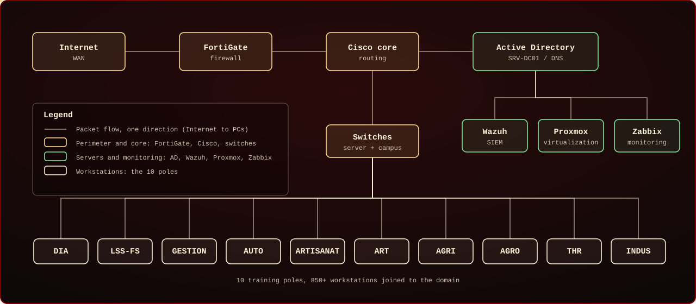

# CMC Infrastructure Toolkit

**Deployment, administration and support of a 650+ workstation campus**

---

## About this repo

PowerShell scripts and procedures built during our end-of-studies internship at the
**Cité des Métiers et des Compétences (CMC) Casablanca-Settat** (Feb–Apr 2026):
deployment, administration and support of the systems and network infrastructure —
a 650+ workstation park across 10 training poles, centralized under a single
Active Directory domain with GPO-driven software deployment and hardening.

**Authors:** Iliass Bouchari & Mohamed Zegui — DTS Digital Infrastructure,
Systems & Networks option, class IDOSR201.

> **Sanitized for publication.** Every real identifier has been replaced by a
> placeholder: domain name (`domain.local`), DC IP (`192.0.2.10`, TEST-NET-1),
> server hostname (`SRV-DC01`), account names (`TECH_ADMIN`) and all passwords
> (interactive prompts). Adapt them to your own environment before use.

## The toolkit at a glance

## Infrastructure it runs on

## Tech stack

## What's inside

### Scripts (`scripts/`)

| Script | What it does |
|--------|--------------|
| `Join-Domain.ps1` | USB-run domain join: sets DNS to the DC, asks for the naming fields, renames the PC and joins the domain directly into the right OU. Cut per-machine setup from ~20 min to under 3 min. |
| `Deploy-App.ps1` | Generic silent EXE deployment via GPO startup scripts, with presence check, logging and public-desktop shortcut. Includes the silent arguments for GNS3, Packet Tracer, Postman, Power BI, Python, VMware, VS Code, XAMPP. |
| `Remove-Office365.ps1` | Complete Click-to-Run Office 365 removal in 4 phases (services, ODT uninstall, Appx leftovers, registry). |
| `AdvancedStartup.ps1` | Disables WinRE entry points, countering the `utilman.exe` → `cmd.exe` SYSTEM-prompt attack. |
| `Manage-LocalUsers.ps1` | Idempotent local-account hygiene: creates the technical admin account and removes unauthorized local users (event-logged). |
| `Set-HPBiosPassword.ps1` | Sets the BIOS admin password on HP machines via HP BiosConfigUtility64, GPO-deployable. |
| `Enable-PsExecSharing.ps1` | Enables remote administration: SMB service, firewall ports 445/135, `LocalAccountTokenFilterPolicy`. |
| `Profile-Cleanup.ps1` | Removes local profiles inactive 30+ days (protecting admin accounts) and reports freed space. |

### Documentation (`docs/`)

- `ad-architecture.md` — OU tree, DNS/SRV logic, software matrix per pole
- `naming-convention.md` — the 10-character workstation naming charter
- `gpo-inventory.md` — every deployed GPO with purpose and target OU
- `boot-repair.md` — Hiren's Boot CD PE boot repair, BIOS lock bypass, utilman-swap countermeasures
- `Rapport_Stage_CMC.pdf` — the full internship report (French), sanitized

## Highlights of the work

- Designed the AD architecture: single domain, 3-level OU tree (administration /
  poles / rooms) enabling per-pole GPO targeting.
- Automated workstation onboarding from ~20 minutes to under 3 minutes per machine.
- Deployed software to 650+ machines by GPO (native MSI + PowerShell for EXE).
- Hardened the park against a password-reset attack actively exploited by students
  (WinRE + utilman.exe swap) with script + GPO + NTFS ACLs.
- Day-to-day helpdesk: network printers, AV equipment, domain incidents
  (secure-channel resets with `netdom resetpwd`, permissions).
- Introduction to perimeter security on the site's Fortinet FortiGate firewall
  (policies, logs, dashboard).

---

